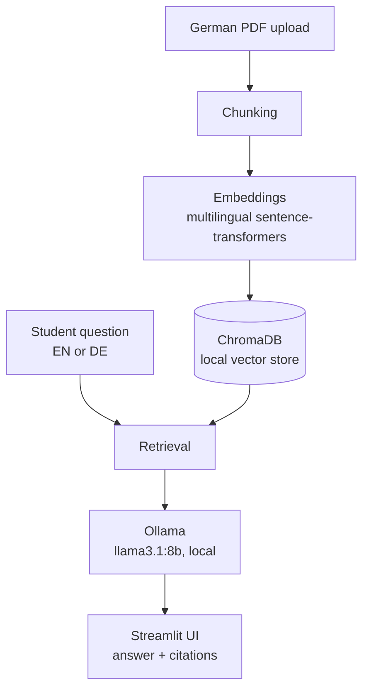

# PDFragen

A RAG (Retrieval-Augmented Generation) chatbot for international students in
Germany. Upload a German-language document — a Studienbüro or Ausländerbehörde
letter, lecture notes, whatever — ask questions about it in English or German,
and get answers grounded in the document with citations back to the source
pages.

> **Fragen** is German for "questions" — PDFragen = "PDF questions".

## Architecture

Fully local RAG pipeline — no paid API required.



## Who this is for

An international student in Germany opens a letter from the Ausländerbehörde.
It is two pages of legal German, it mentions a deadline, and getting it wrong
means losing the right to stay. Machine translation gives a wooden rendering of
the whole page; it does not answer "so what do I actually need to bring, and
by when?"

PDFragen is built for that moment. Upload the letter, ask the question in
whichever language is easier, and get a direct answer with the source passage
and page number shown underneath — so the answer can be checked against the
document rather than trusted blindly.

The same thing works for lecture notes, exam regulations, and enrollment
paperwork. Two sample documents ship in [`examples/`](examples/) if you want to
try it without uploading anything of your own.

**Everything runs locally and free** — local LLM via Ollama, local embeddings,
local vector store. No API keys, no per-query cost, and no document ever leaves
the machine. For paperwork containing passport numbers and financial details,
that last point is the design constraint, not a nice-to-have.

## Design notes

A few decisions a reviewer might reasonably ask about:

- **Why a multilingual embedding model?** Questions arrive in English, but the
  documents are German. `paraphrase-multilingual-MiniLM-L12-v2` maps both into
  one space, so an English question retrieves the relevant German passage
  without a translation step in between.
- **Why cite pages rather than just answer?** The user usually has to act on
  the document (submit a form, hit a deadline). An unverifiable answer is not
  much use, so every answer carries the passages it came from.
- **Why the repeated language instruction in the prompt?** The excerpts are
  German, and an 8B model tends to answer in the language of the *context*
  rather than the *question*. Restating the rule after the question fixed this
  in practice — see `_PROMPT_TEMPLATE` in [`rag.py`](src/pdfragen/rag.py).
- **Why hash-based chunk ids?** Re-uploading the same document overwrites its
  chunks instead of duplicating them, which would otherwise skew retrieval
  toward whatever had been ingested twice.
- **Why keep styling in its own module?** [`theme.py`](src/pdfragen/theme.py)
  holds the palette, type scale and CSS so `app.py` reads as layout and state
  rather than a wall of style strings — and so a visual change never risks
  touching the pipeline.

## Stack

| Concern      | Choice                                              |
| ------------ | ---------------------------------------------------- |
| RAG pipeline | LangChain                                            |
| Vector store | ChromaDB (local, persisted)                          |
| Embeddings   | `paraphrase-multilingual-MiniLM-L12-v2` (local)      |
| Generation   | Ollama, `llama3.1:8b` (local, configurable)          |
| UI           | Streamlit                                            |
| Config       | python-dotenv                                        |

## Setup

```bash
python -m venv venv && source venv/bin/activate
pip install -r requirements.txt
cp .env.example .env   # defaults work for a local Ollama install

# Ollama must be running with the model pulled:
ollama pull llama3.1:8b
```

Requires Python 3.11+ and [Ollama](https://ollama.com) installed locally.

## Usage

Make sure Ollama is running (`ollama serve`), then launch the app:

```bash
streamlit run app.py
```

Drop a PDF on the landing screen, wait for indexing, and ask away.

Every answer is followed by citation pills — one per cited page, badged `p. 2`
for an English answer and `S. 2` for a German one — and an expander holding the
passages those pages were drawn from, so any claim can be checked against the
document. Each message carries an EN/DE chip showing the language it was
handled in. The sidebar's language control forces answers into English or
German; on *Auto* the answer matches the question.

Each uploaded document is indexed into its own collection, scoped to the
browser session — re-uploading the same file reuses the existing index instead
of re-embedding it.

### Try it with the sample documents

Two synthetic German documents are included, so reviewers can see the thing work
without supplying paperwork of their own:

| File | What it is | Questions worth asking |
| ---- | ---------- | ---------------------- |
| [`auslaenderbehoerde_verlaengerung.pdf`](examples/auslaenderbehoerde_verlaengerung.pdf) | A residence-permit extension letter | "What documents do I need to bring?" · "How many days a year may I work?" · "Wann ist die Frist?" |
| [`vorlesung_maschinelles_lernen.pdf`](examples/vorlesung_maschinelles_lernen.pdf) | Lecture notes on regularization | "What is the difference between L1 and L2?" · "When is the exercise sheet due?" |

Both are generated by [`examples/make_samples.py`](examples/make_samples.py) and
contain no real personal data.

### CLI

The pipeline stages are also runnable standalone, useful for inspecting
behaviour without the UI:

```bash
python -m pdfragen.ingestion path/to/dokument.pdf    # chunk stats
python -m pdfragen.vectorstore path/to/dokument.pdf  # chunk + embed + store
python -m pdfragen.rag "Wie lange habe ich Zeit?"    # retrieve + answer
```

## Project structure

```
PDFragen/
├── app.py               # Streamlit chat UI
├── src/pdfragen/        # library code
│   ├── config.py        # env-driven configuration
│   ├── ingestion.py     # PDF loading + German-aware chunking
│   ├── vectorstore.py   # embeddings + persistent ChromaDB
│   ├── rag.py           # retrieval + Ollama generation
│   └── theme.py         # design tokens + injected CSS for the UI
├── .streamlit/          # native Streamlit theming
├── tests/               # unit tests
├── examples/            # sample German PDFs + the script that builds them
├── requirements.txt
├── pyproject.toml
└── .env.example
```

## Limitations

Worth being explicit about, since they shape what this does and doesn't do:

- **Scanned PDFs are not supported.** Text is extracted, not OCR'd; an
  image-only PDF is rejected with a clear message rather than silently
  returning nothing.
- **Answer quality is bounded by an 8B local model.** The tradeoff is
  deliberate — privacy and zero cost over raw quality — but a larger model via
  `LLM_MODEL` noticeably improves multi-step questions.
- **No conversational memory.** Each question is retrieved and answered
  independently; follow-ups like "and what about the other one?" won't resolve.
- **One document at a time.** Uploading a new PDF replaces the indexed one
  rather than adding to it; questions can't span two documents.
- **It runs where Ollama runs.** That rules out zero-config hosts like
  Streamlit Community Cloud — the model is several GB and needs a local
  daemon. Demoing it means running it locally or recording it.
- **Chunking is character-based.** It respects paragraph and sentence
  boundaries, but a table split across a chunk boundary can still lose context.
- **This is not legal advice.** It helps read a document; it does not tell
  anyone what to do about it.

## License

MIT
