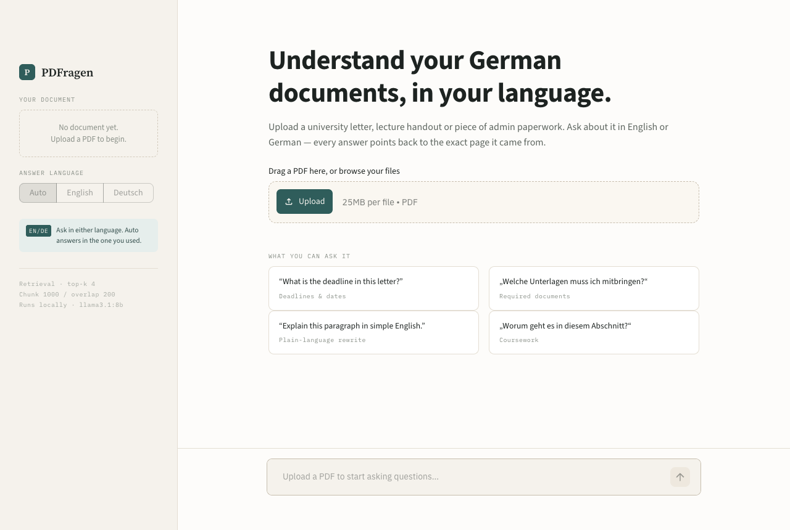
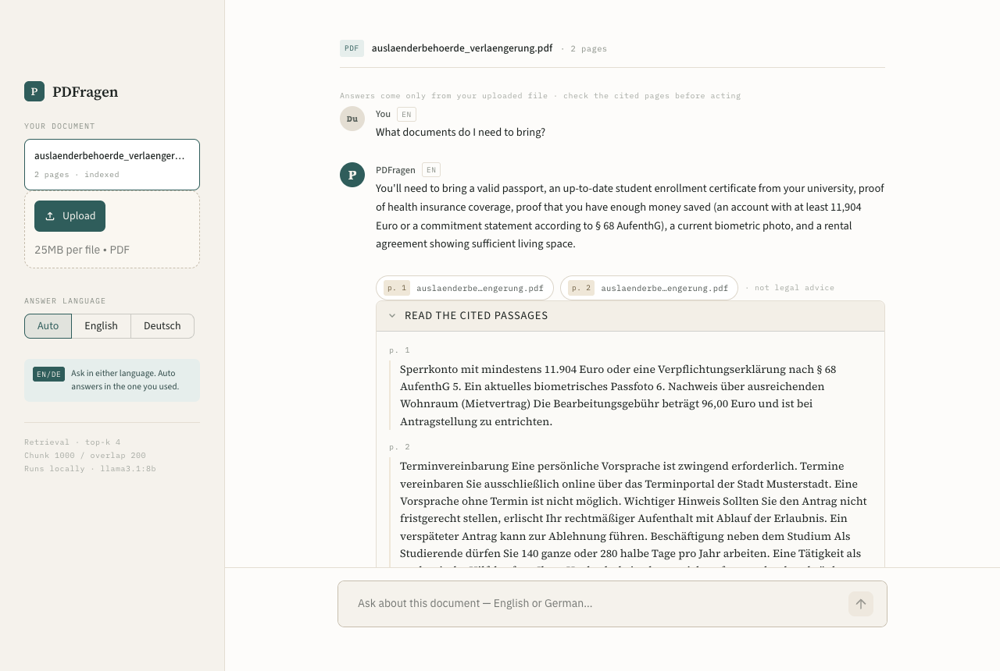

# PDFragen User Guide

## 1. What PDFragen does

This guide is for people who have never used a terminal. You have a German
letter or PDF that you don't fully understand. PDFragen reads
it for you. You ask a question in English or German, for example "What is the
deadline?", and it answers in plain language. Under each answer it shows the
page numbers and the exact German sentences it used, so you can check them.

## 2. Your privacy

PDFragen runs on your own computer. Your document is read, stored and answered
on your machine. It is not uploaded to any website or AI company.

- **The AI runs on your computer.** It uses **Ollama**, a free program that runs
  AI models on your own computer instead of on the internet.
- **You need the internet for setup and for your first upload**, to download
  the programs and two AI models. Your documents are never sent anywhere.
- **Small exception:** the app page loads its fonts from Google Fonts. Google
  can see that you opened the app, but not your document or your questions.
- **Start the app with the command in step 7 below.** It includes
  `--server.address 127.0.0.1`. Without this part, other people on the same
  Wi-Fi (for example in a student dorm) could open your PDFragen page.
- **A copy of each uploaded PDF stays on your computer** after you close the
  app. See "How do I delete my documents?" in the FAQ.

## 3. Before you start

These steps were tested on a Mac. Windows and Linux need different commands,
and those are not covered here. You need about **8 GB of free disk space**.
While it answers, the AI model uses about 5 GB of memory (RAM).

**How long it takes:** you download about 7 GB in total. The AI model is the
biggest part (4.9 GB). On a normal home connection, expect roughly 15 to 30
minutes. On slow Wi-Fi it can take over an hour. You only do this once.

1. **Install Python** (the language PDFragen is written in). Download it from
   [python.org/downloads](https://www.python.org/downloads/) and run the installer.
2. **Install Ollama.** Download it from [ollama.com/download](https://ollama.com/download),
   move it to your Applications folder and open it. A small llama icon appears
   in the menu bar at the top of your screen.
3. **Download PDFragen.** On the project's GitHub page, click the green **Code**
   button, then **Download ZIP**. Double-click the ZIP in your Downloads folder
   to unpack it.
4. **Open the Terminal**, the program where you type commands. Press
   `Cmd + Space`, type `Terminal` and press Enter.
5. **Go to the PDFragen folder.** Copy this line, paste it into the Terminal
   and press Enter. If your folder has a different name, change the end of
   the line to match it.

   ```bash
   cd ~/Downloads/PDFragen-main
   ```

6. **Install PDFragen.** Paste these lines one at a time, pressing Enter after
   each one. Wait until each command has finished. The last one downloads the
   4.9 GB AI model.

   ```bash
   python3 -m venv venv
   source venv/bin/activate
   pip install .
   ollama pull llama3.1:8b
   ```

   If `python3 -m venv venv` shows an error, type `python3 --version`. It must
   say 3.11 or higher. If it doesn't, install Python again from step 1.

7. **Start PDFragen.** Paste this line and press Enter:

   ```bash
   streamlit run app.py --server.address 127.0.0.1
   ```

   Your web browser opens the app. Keep the Terminal window open while you use
   PDFragen. To stop the app, click the Terminal and press `Ctrl + C`.

**Next time**, you skip the installation. Open the Terminal and paste:

```bash
cd ~/Downloads/PDFragen-main
source venv/bin/activate
streamlit run app.py --server.address 127.0.0.1
```

## 4. How to use it

1. **Upload a PDF.** Click **Upload** and choose your file, or drag the file
   onto the box. Files can be up to 25 MB.

   

2. **Wait a few seconds.** PDFragen reads your file. The very first upload
   also downloads a small model (about 0.5 GB), so it takes longer. After that,
   the first upload after starting the app took about 40 seconds in our test.
3. **Ask a question** in the box at the bottom of the screen. Type in English
   or German and press Enter. An answer usually takes 10 to 20 seconds.
4. **Read the answer, then check it.** Under the answer you see page labels
   such as `p. 1` (in German answers: `S. 1`, for *Seite*). Click **Read the
   cited passages** to see the German sentences the answer came from.

   

**Answer language:** on **Auto**, the answer uses the language of your
question. To always get English or German, choose **English** or **Deutsch**
in the left sidebar.

**A new document:** use the **Upload** box in the left sidebar. The new file
replaces the old one. PDFragen works with one document at a time.

## 5. Good questions to ask

Ask about one thing at a time, and name it clearly. Good examples:

- "What is the deadline for applying for the extension?"
- "What documents do I need to bring to the appointment?"
- "How much is the fee, and when do I have to pay it?"
- „Wie viele Tage im Jahr darf ich arbeiten?“ ("How many days a year may I work?")

A bad (too vague) question: **"What does this mean?"** PDFragen only looks at
the few passages that best match your question, so with a vague question it
may look at the wrong part of the letter.

Ask each question in full. PDFragen does not remember your earlier questions,
so a question like "and what about the second one?" won't work.

## 6. When not to trust the answer

PDFragen helps you read a document. It can still be wrong.

- **Always check deadlines, amounts and dates in the original letter.** Open
  **Read the cited passages** and compare. PDFragen uses a small AI model that
  can make mistakes.
- **Be careful with PDFs from unknown senders.** A PDF can contain hidden text
  that you can't see, but the AI can read. In our tests, hidden text made the AI
  say "the deadline has already passed" when it had not. If an answer
  surprises or scares you, check the letter yourself.
- **Don't click links or visit websites that appear only in an answer.** Use
  only web addresses and phone numbers printed in the original letter.
- **This is not legal advice.** For your residence permit, visa or anything
  with legal consequences, ask your university's international office, a
  student advice service or the authority that sent the letter.
- **Use the page labels under the answer, not page numbers in the answer
  text.** The answer text sometimes mentions "excerpts" or a page number that
  is one lower than the real page. The labels (`p. 1`, `p. 2`) are correct.
- **If the answer comes in the wrong language,** choose **English** or
  **Deutsch** in the sidebar and ask again.

## 7. FAQ and troubleshooting

**The app says "Can't reach Ollama".**
Ollama is not running. Open the Ollama app from your Applications folder and
wait until the llama icon appears. Then reload the browser page.

**The app says the model "isn't installed".**
The AI model download did not finish. In the Terminal, run
`ollama pull llama3.1:8b` again and wait until it says `success`.

**The app says "No extractable text".**
Your PDF is probably a scan or a photo of a letter. PDFragen can only read
PDFs with real text (text you can select and copy in a PDF viewer). It
can't read text inside images.

**Answers are slow.**
The AI runs on your own computer, so speed depends on your computer. Close
other big programs. The first upload and the first answer after starting the
app are always the slowest.

**How do I delete my documents?**
PDFragen keeps a copy of every uploaded PDF in a temporary folder. To delete
these copies, stop the app first (`Ctrl + C`), then paste this into the
Terminal:

```bash
rm -rf "$TMPDIR"/pdfragen_*
```

## 8. Limitations

- Only text PDFs work. Scanned letters and photos don't.
- One document at a time. Questions can't cover two files.
- It does not remember earlier questions.
- It can miss information. For example, it may list only some of the
  documents you need. Tables are the most likely to come out wrong.
- It only runs on your own computer, with Ollama open. There is no online
  version.
- It is not legal advice.
